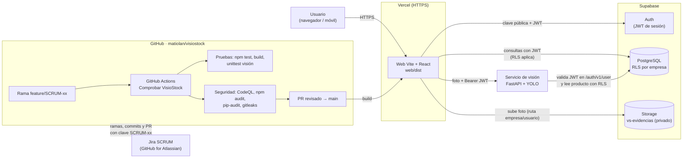

# Arquitectura de VisioStock y revisión de seguridad (SCRUM-66)

Sprint 4 · Seguridad — Épica EP7 (SCRUM-64). Revisión hecha sobre `main` al 04/11/2026.

## Diagrama

## Controles presentes

| Zona | Control | Evidencia |
| --- | --- | --- |
| Web | Solo URL y clave **pública** de Supabase; nada de `service_role` | `web/.env.example`, `web/LEEME_PRIMERO.md` |
| Web | Validación de tipo y tamaño de foto (JPG/PNG/WebP, ≤ 5 MB) | `web/src/Verificaciones.tsx` |
| Web | Vista previa dibujada en canvas (sin datos del usuario en `src`) | SCRUM-68 |
| Base de datos | RLS activo en todas las tablas `vs_*`; acceso por empresa con `vs_acceso()` | `supabase/esquema.sql` |
| Base de datos | Funciones `security definer` con `search_path` fijo | `supabase/esquema.sql` |
| Base de datos | Movimientos sin políticas de UPDATE/DELETE (registro inmutable) | `supabase/esquema.sql` |
| Storage | Bucket privado con límite de tamaño y tipos MIME; escritura solo en la ruta del propio usuario | `supabase/02_verificaciones.sql` |
| Visión | Exige `Authorization: Bearer`; valida el token con Supabase Auth y consulta con RLS | `vision/app.py` |
| Visión | CORS restringido a `VISION_ORIGINS`; límite de píxeles de imagen | `vision/app.py` |
| Repositorio | `.env` ignorado por git; gitleaks en el pipeline | `.gitignore`, SCRUM-65 |
| Pipeline | CodeQL, npm audit, pip-audit y gitleaks en cada rama y PR; fallan ante hallazgos | SCRUM-65 |

## Brechas encontradas y seguimiento

| # | Brecha | Riesgo | Historia | Estado |
| --- | --- | --- | --- | --- |
| 1 | El pipeline no tenía pruebas de seguridad y solo corría en `main` | Vulnerabilidades llegan a producción sin detectarse | SCRUM-65 | Corregido en esta rama |
| 2 | Pillow 12.x con 39 vulnerabilidades conocidas (pip-audit) | Imágenes manipuladas en el servicio de visión | SCRUM-67 | Corregido (Pillow 13) |
| 3 | CodeQL `js/xss-through-dom` en la vista previa de evidencia | XSS desde el archivo elegido | SCRUM-68 | Corregido (canvas) |
| 4 | `main` sin protección de rama (se puede hacer push directo) | Cambios sin revisión ni pipeline en verde | SCRUM-65 | Corregido: protección de `main` con PR, 1 aprobación y 7 checks obligatorios |
| 5 | `web/vercel.json` sin cabeceras de seguridad (CSP, X-Frame-Options, X-Content-Type-Options, Referrer-Policy) | Clickjacking y menor defensa ante XSS | SCRUM-68 | Corregido (PR #9) |
| 6 | Servicio de visión sin límite de tamaño de petición ni límite de frecuencia, y aún sin despliegue HTTPS | Abuso / denegación de servicio | SCRUM-67 | Pendiente |
| 7 | Variables de Supabase en Vercel y prueba de aislamiento entre empresas | Datos de ejemplo en producción / fuga entre empresas | SCRUM-62, SCRUM-69 | Corregido: producción con Supabase real; prueba de aislamiento aprobada |
| 8 | 4 funciones SECURITY DEFINER ejecutables sin sesión (`anon`): `esquema.sql` solo revocaba a `public` | Superficie expuesta sin autenticación | SCRUM-72 | Corregido: `supabase/03_endurecer_seguridad.sql` + prueba `vision/test_permisos_sql.py` en el pipeline |
| 9 | Registro público de cuentas habilitado aunque la app no tiene formulario de registro | Creación de cuentas no autorizadas | SCRUM-72 | Corregir en Supabase → Authentication |
| 10 | Protección de contraseñas filtradas (HaveIBeenPwned) desactivada | Contraseñas comprometidas | SCRUM-72 | Riesgo aceptado: requiere plan Pro |
| 11 | 7 funciones ejecutables por usuarios con sesión (aviso del Security Advisor) | — | SCRUM-72 | Riesgo aceptado: son las RPC de la app y cada una valida empresa y rol |

## Cómo se mantiene

Cada cambio entra por una rama `feature/SCRUM-xx-...`. El pipeline corre en esa rama; si un job de **Seguridad** falla, se corrige en la misma rama y se vuelve a subir. Solo con todo en verde y una aprobación se fusiona a `main`.
