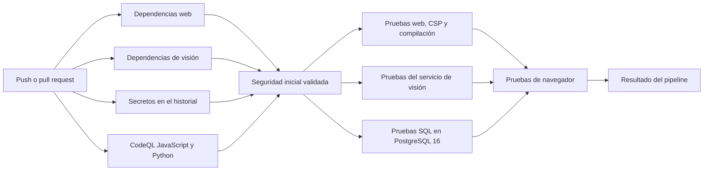

# Pipeline de integración de VisioStock

El workflow `.github/workflows/pruebas.yml` valida los cambios de todas las ramas y los pull requests hacia `main`. También permite ejecución manual. Los nombres de las comprobaciones anteriores se conservan para mantener la compatibilidad con las reglas existentes del repositorio.

## Orden de ejecución

| Etapa | Comprobaciones | Condición para continuar |
| --- | --- | --- |
| 1. Seguridad inicial | `npm audit`, `pip-audit`, Gitleaks y CodeQL en ambos lenguajes | Todas deben terminar satisfactoriamente. El trabajo `seguridad-validada` reúne estos resultados. |
| 2. Pruebas y compilación | Pruebas web, cabeceras/CSP y TypeScript/Vite; pruebas Python; aislamiento SQL, permisos, doble factor y horario laboral | Los trabajos `web`, `vision` y `seguridad-sql` se ejecutan en paralelo después de la seguridad inicial. |
| 3. Navegador | Playwright con Chromium: portada, navegación, acceso y recuperación en distintos tamaños | Comienza después de que los tres trabajos de la etapa 2 terminen correctamente. |
| 4. Resultado | Tabla con el resultado de cada trabajo en el resumen de Actions | Falla si cualquier dependencia falla o se omite. También publica el resumen después de un fallo; las ejecuciones canceladas no se presentan como aprobadas. |

Las dependencias `needs` controlan el orden real del gráfico de GitHub Actions. Los comentarios y nombres de pasos describen ese mismo orden dentro del YAML.

## Evidencia y controles de ejecución

- Las capturas del navegador se guardan en el artefacto `capturas-pagina-de-inicio`.
- La prueba de doce escenarios del portal guarda su salida en `resultado-portal-dos-empresas`.
- La tabla final se consulta en el resumen de la ejecución. Los detalles y errores permanecen en los registros de cada trabajo.
- Cada trabajo tiene un tiempo máximo. Una ejecución nueva cancela las anteriores del mismo PR o rama, salvo `main`.
- El permiso general es lectura del código. Solo CodeQL conserva los permisos adicionales necesarios para publicar su análisis. Las acciones permanecen fijadas por SHA y el checkout no conserva credenciales.

## Alcance y revisión

Validación local de la reorganización (20/11/2026): `actionlint 1.7.12` sin errores; grafo sin ciclos; conservación de los comandos, acciones y nombres anteriores; cuatro comprobaciones del resumen (todo correcto, fallo, omisión y cancelación) con la salida esperada. Estas comprobaciones locales no sustituyen la ejecución del nuevo commit en GitHub Actions.

Esta reorganización pertenece a la rama de Mia y a la PR #28, con trazabilidad en SCRUM-58 y SCRUM-68. El cambio debe revisarse antes de fusionarlo. No modifica por sí mismo las reglas de protección de `main`.

El workflow comprueba código y seguridad en un entorno de pruebas. El despliegue de Vercel es una integración separada: un pipeline aprobado no demuestra que se haya publicado una versión. Las sesiones con usuarios reales y la validación de una cámara física se documentan por separado.

Referencias: [sintaxis de workflows de GitHub](https://docs.github.com/en/actions/reference/workflows-and-actions/workflow-syntax) y [expresiones y condiciones de estado](https://docs.github.com/en/actions/reference/workflows-and-actions/expressions).
